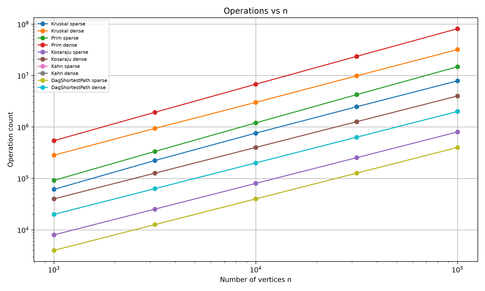
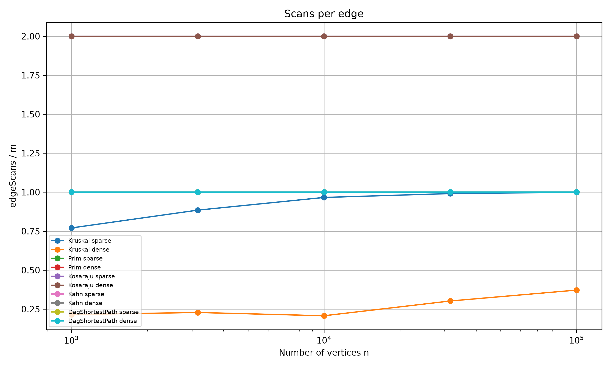
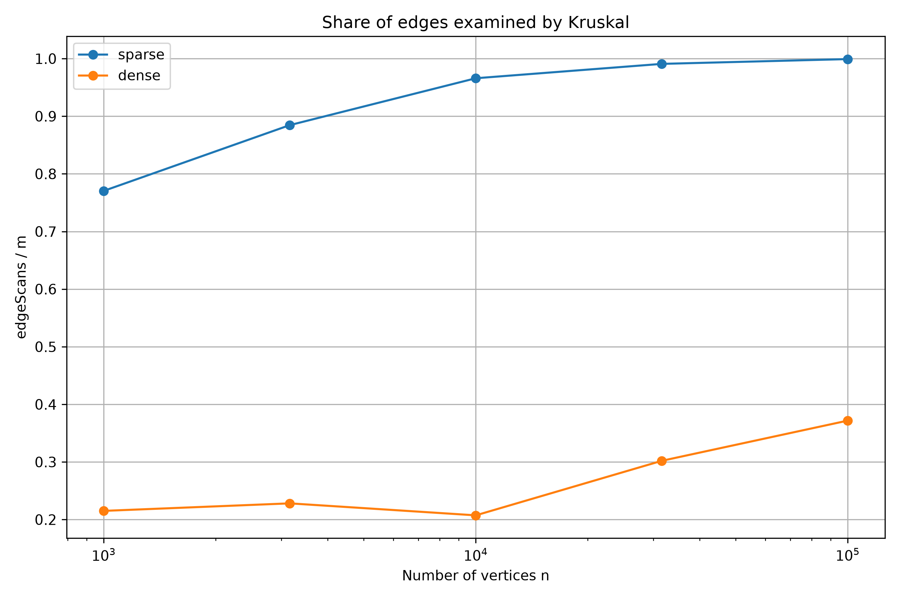

# Assignment 3 Report
## Graphs: DSU, MST, SCC and Shortest Paths

## 1. Complexity Table

| Algorithm | Time Complexity | Extra Space | Justification |
|---|---:|---:|---|
| DSU find / union | O(α(n)) amortized | O(n) | Union by rank and path compression keep the trees very shallow. |
| Kruskal | O(E log E) | O(V + E) | The edges are sorted by weight, then DSU is used to detect cycles. |
| Prim | O(E log V) | O(V + E) | A priority queue is used to repeatedly choose the minimum-weight edge. |
| Kosaraju | O(V + E) | O(V + E) | Two DFS passes are performed: one on the original graph and one on the reversed graph. |
| Kahn | O(V + E) | O(V) | Each vertex enters the queue once and each edge is processed once. |
| DAG Shortest Path | O(V + E) | O(V) | After topological ordering, every edge is relaxed exactly once. |

DSU uses two optimizations: union by rank and path compression. Because of these optimizations, find and union have almost constant amortized cost, O(α(n)).

Kruskal first sorts all edges by weight. Sorting dominates the running time, therefore its complexity is O(E log E). Prim uses a priority queue and processes graph edges while growing the minimum spanning tree.

Kosaraju performs two graph traversals and therefore has linear complexity O(V + E). Kahn's algorithm and the DAG shortest-path algorithm also process every vertex and edge a constant number of times.

---

## 2. Counters vs Formulas

The benchmark used five graph sizes:

- 1,000
- 3,162
- 10,000
- 31,623
- 100,000

For every size, two densities were tested:

- Sparse graph: m = 4n
- Dense graph: m = 20n

The operation counters confirm the expected complexity.

For Kosaraju:

edgeScans / m = 2

for every tested graph. This is expected because Kosaraju scans all edges in the first DFS and all edges again in the reversed graph.

For Kahn:

edgeScans / m = 1

for every tested graph because every edge is processed once while reducing indegrees.

For DAG Shortest Path:

edgeScans / m = 1

because each edge is relaxed exactly once during the pass over the topological order.

Prim also scanned approximately one set of graph edges in the implementation, giving an edgeScans / m ratio of 1.

For Kruskal, the share of examined edges depended on the density. On sparse graphs, the ratio increased from approximately 0.77 to almost 1.00. On dense graphs, Kruskal often completed the MST before examining every edge, so the ratio was considerably smaller.

These stable ratios provide empirical confirmation of the theoretical complexity classes.

---

## 3. Correctness of Kruskal and Prim

Both Kruskal and Prim are based on the cut property of minimum spanning trees. Consider any cut that divides the vertices into two groups. The minimum-weight edge crossing that cut is safe to add to a minimum spanning tree.

Kruskal sorts all edges from the smallest weight to the largest. When it finds an edge connecting two different DSU components, it adds that edge. Since the two vertices are in different components, adding the edge does not create a cycle. The chosen edge is the lightest available safe edge between components.

Prim uses the same cut property in a different way. It maintains a growing tree and repeatedly chooses the smallest edge connecting the current tree to a vertex outside it. Therefore every selected edge is safe according to the cut property.

The benchmark automatically compared the total weights produced by Kruskal and Prim. For every tested graph, the two algorithms produced exactly the same MST total weight.

---

## 4. Correctness of DAG Shortest Paths

The shortest-path algorithm processes vertices in topological order.

In a topological order, every edge u → v goes from an earlier vertex u to a later vertex v. Therefore, when vertex u is processed, all possible predecessors that could improve the distance to u have already been processed.

The algorithm then relaxes every outgoing edge of u. After u is processed, its shortest distance is final because no later vertex can have an edge back to u in a DAG.

By induction, the distance of every vertex is correct when it is processed. Therefore one pass through the vertices in topological order is sufficient.

Negative edge weights are allowed because a DAG contains no cycles. As a result, a negative-weight cycle cannot exist.

---

## 5. Which Algorithm When?

| Situation | Recommended Algorithm | Reason |
|---|---|---|
| Minimum spanning tree with an edge list | Kruskal | Sorting an edge list is simple and DSU detects cycles efficiently. |
| Sparse graph | Kruskal | It works efficiently when the number of edges is relatively small. |
| Graph stored as adjacency lists | Prim | Prim naturally explores neighbours using a priority queue. |
| Dense MST graph | Prim | It can avoid globally processing every edge in sorted order. |
| Need strongly connected components | Kosaraju | It finds all SCCs in O(V + E). |
| Need topological ordering | Kahn | It uses indegrees and also directly detects cycles. |
| Directed graph may contain a cycle | Kahn for cycle detection | If fewer than n vertices are processed, a cycle exists. |
| Shortest paths in a DAG | DAG Shortest Path | It runs in O(V + E) and supports negative edge weights. |
| General graph with arbitrary cycles | Do not use DAG shortest path | The topological-order method requires an acyclic graph. |

For an MST, I would usually choose Kruskal when the graph is naturally represented as an edge list or is relatively sparse. I would choose Prim when the graph is already represented using adjacency lists and I want to grow the tree directly from neighbouring vertices.

---

## 6. Slope Check

The edge-scan curves were examined on log-log axes.

For Prim, Kosaraju, Kahn and DAG Shortest Path, the measured slope was approximately:

1.00

A slope of 1 on a log-log graph indicates linear growth.

For Kruskal, the measured edge-scan slopes were approximately:

- Sparse graphs: 1.06
- Dense graphs: 1.12

Kruskal is slightly steeper than the pure traversal algorithms. Its full theoretical complexity also contains the sorting term O(E log E).

The measurements therefore agree with the expected theoretical behaviour.

---

## 7. Plots

### Operations vs n

The log-log plot shows how the operation counts grow as the graph size increases. Traversal-based algorithms show approximately linear growth, while MST algorithms also include priority-queue or sorting work.

### Scans per Edge

Kosaraju remains at approximately 2 scans per edge because it performs two DFS passes. Kahn and DAG Shortest Path remain at approximately 1 scan per edge, confirming linear traversal behaviour.

### Share of Edges Examined by Kruskal

On sparse graphs, Kruskal eventually examines almost all edges before completing the MST. On dense graphs, it can often complete the spanning tree after examining only a fraction of all available edges.

---

## 8. Benchmark Results

The program reproduced the required reference values exactly.

Examples include:

| n / m | MST Weight | SCC Count | Sum of DAG Distances |
|---|---:|---:|---:|
| 1,000 / 4,000 | 147,970 | 27 | 396,274 |
| 1,000 / 20,000 | 30,363 | 1 | 252,411 |
| 10,000 / 40,000 | 1,486,139 | 373 | 3,941,828 |
| 100,000 / 400,000 | 15,012,094 | 3,923 | 40,096,539 |
| 100,000 / 2,000,000 | 3,056,681 | 1 | 23,512,087 |

Kruskal and Prim produced equal MST weights on every generated undirected graph.

---

## 9. Running Time

Wall-clock time was measured as the median of five runs. The measured time increased with graph size and density, but time was not used as the main evidence of complexity.

Execution time depends on the computer, JVM version, operating system and background processes. For this reason, operation counters are more reliable and reproducible than wall-clock measurements.

The counter results followed the expected theoretical behaviour across all graph sizes.

---

## 10. Conclusion

This assignment implemented a common graph representation and six graph-related algorithms: DSU, Kruskal, Prim, Kosaraju, Kahn and DAG shortest paths.

The algorithms were tested on small graphs and benchmarked on graphs with up to 100,000 vertices and 2,000,000 edges. Iterative DFS allowed Kosaraju to work safely on 100,000 vertices without StackOverflowError.

The benchmark reproduced the required reference values. Kruskal and Prim agreed on MST weights, Kosaraju correctly found SCCs, Kahn detected cycles and produced valid topological orders, and DAG shortest paths correctly handled both positive and negative edge weights.